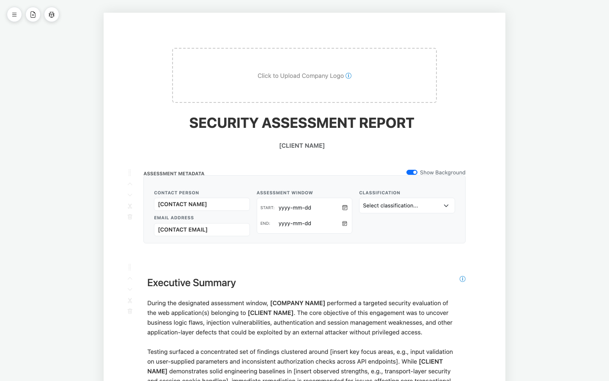

# Security Assessment Reporter

A client-side report builder for writing and exporting professional security / penetration testing assessment reports — no build step, no backend, no account, no data leaving your browser.

**🔗 Live demo: [jozeta.github.io/rapportgenerator/rapportgenerator.html](https://jozeta.github.io/rapportgenerator/rapportgenerator.html)** — hosted on GitHub Pages, so it's served over `https://` and fully functional (the `library.json`/`report-defaults.json`/`settings.json` fetches that fail under `file://` work fine there).

The app itself — the editor, the risk matrix, the PDF export — is a single HTML file, `rapportgenerator.html`, with no separate CSS/JS files and no build step. Three optional JSON files sitting next to it — `library.json` (the vulnerability template library), `report-defaults.json` (the report's default boilerplate text), and `settings.json` (firm-wide defaults) — extend it further — see [How it works](#how-it-works) and [Firm-wide settings](#firm-wide-settings) below — but the app runs and remains useful with just the HTML file on its own.

## Screenshot

## Why

Most pentest reporting workflows bounce between a Word template, a spreadsheet of CVSS scores, and a folder of screenshots. This tool collapses that into one page: pick findings from a built-in library of 270+ pre-written vulnerability templates, drop them into the report, fill in the specifics, drag things into the order you want, and print straight to PDF.

## Features

**Report structure**
- Pre-built sections: Executive Summary, Confidentiality Notice, Disclaimer, Purpose, Summary, Engagement & Scope, Methodology (with a scoring-key table), Findings Summary, Detailed Findings, Conclusion
- Add custom text sections or additional Detailed Findings sections from a dedicated modal (opened via the icon beside the sidebar hamburger, or the matching icon in the sidebar's action row), keeping the report canvas uncluttered
- Every section has an icon rail on its left edge — drag handle, move up, move down, insert page break below, and delete — all matching the same monochrome Bootstrap Icon style and hover behavior
- A toggleable, auto-generated Table of Contents that links to every section heading and stays in sync as you add, remove, or reorder sections — and is itself draggable like any other block
- Writing guidance for the narrative sections (Executive Summary, Purpose, Summary, Scope, Conclusion) lives behind an ⓘ info icon next to each heading — hover for what belongs in that section; the tooltip never appears in print
- A **Report Template** dropdown above Target Profiles lays out the report for the kind of engagement. Each template has its own sections, headings, order and default text, its own rating scale (*Exploitability* for penetration tests, *Likelihood* for reviews) and its own label for what a finding affects (e.g. "Affected Files / Components" in a code review). Out of the box:
  - **Penetration tests:** Web Application, Infrastructure, Mobile Application, API, Cloud Security Assessment, and Red Team / Adversary Simulation.
  - **Reviews and assessments:**
    - **Code Review:** repositories and commit reviewed, review approach (SAST, SCA, secret scanning, manual review), secure development recommendations.
    - **General Security Review:** background and objectives, scope and approach, a control-area maturity table, observations, and a roadmap.
    - **Vulnerability Assessment:** targets and scan type, a results table, remediation priorities.
    - **Phishing / Social Engineering:** rules of engagement, campaign scenario, a results table, awareness and technical recommendations.
    - **Configuration Review:** systems and baseline, review approach, a baseline compliance table.

  Switching template replaces only the template's own sections. Your findings, sections you added, extra findings sections and an ongoing retest are kept. The app asks first, unless the report is untouched, and the switch can be undone. Templates are defined in `report-defaults.json`, so adding one there is enough to make it show up.

**Interface language**
- The interface (buttons, menus, tooltips, dialogs, messages) is in **English or Swedish**. By default it follows the browser's language; **Settings → Interface Language** picks one, and the choice is remembered in this browser. Switching is instant and doesn't touch the report's text.

**Report language**
- Each report is written in **English or Swedish**, chosen under **Report Language** (below Report Template) and saved in the report file. It is independent of the interface language: a Swedish consultant can write an English report and vice versa.
- In Swedish, every template comes with Swedish headings, default text, writing tips, rating scale and legend, and the labels the app prints are Swedish: severities (Kritisk, Hög, Medel, Låg), statuses (Öppen, Åtgärdad, Delvis åtgärdad, Accepterad risk, Falsk positiv), finding-card labels, the action planner, the retest table, metadata labels, the Table of Contents title and figure captions ("Figur 1:"). Placeholders read `[infoga …]` and the Pre-Export Checklist flags them like `[insert …]`.
- Changing the language starts a new, empty report in that language (same Report Template): the current report (findings, section text, logo and the autosaved draft) is cleared and the page reloads with the template in the new language. The app asks first, so you can export the report before. Client, company, contact, dates and classification are kept. Statuses are stored in English either way, so files stay compatible, and importing a report file opens it in the language it was saved in.
- A new report starts in the language of your last report, or the interface language the first time. Reports saved before this existed open as English.
- The vulnerability library follows the report language: in a Swedish report, **Add New Finding** lists the templates with Swedish titles and fills in Swedish descriptions and remediation (from `library.sv.json`). Search works with English or Swedish words. CWE and category stay as they are, and templates you added yourself are shown as you wrote them.
- Changing the language keeps the chosen Report Template: the new, empty report is built from the same template in the new language.

**Findings**
- A searchable, filterable library of 270+ vulnerability templates spanning OWASP Top 10, Active Directory, Windows, Linux, Cloud (AWS/Azure-agnostic), Azure, M365/Intune, Kubernetes/Containers, Databases, DevOps, Networking, Wireless, Mobile, Physical, IAM, Secrets, Backup, Monitoring, SaaS, and more — each with a title, CWE ID, description, and remediation text pre-filled, ready to customize, opened from the same "Add New Finding" modal
- A 1–5 × 1–5 Impact/Exploitability scoring matrix per finding, auto-plotted onto a visual 5×5 risk-matrix diagram and rolled up into a Critical/High/Medium/Low executive summary table — findings start unscored ("Not Scored") rather than defaulting to a mid-range score
- Finding status tracking (Open / Remediated / Partially Remediated / Accepted Risk / False Positive, starting as "Not Set") with a retest date field, for reports that go through a retest cycle
- Affected-assets tagging per finding (add/edit/remove asset badges inline) — hidden entirely on print when a finding has no assets linked
- An optional CVSS v3.1 field per finding (vector string + numeric base score), shown in its metadata box under Category/CWE, with a link to the official FIRST.org calculator to work out the score — this app only records the result, it doesn't calculate CVSS itself. Hidden entirely on print when left blank
- Finding status is likewise hidden entirely on print while it's still "Not Set", instead of printing a visible "not set" badge
- CWE IDs auto-link to the relevant [cwe.mitre.org](https://cwe.mitre.org) definition
- Optional "Remediation Action Planner" block per finding (owner / priority / target date / notes) — printable, hidden by default, and toggleable per finding or for every finding at once (see below)
- Each finding has its own icon row — move up, move down, toggle page break above, toggle its Action Planner, delete — right-aligned above the finding title, styled and sized to match the section icon rail, including the same hover reveal
- Drag-and-drop reordering of findings, including across different Detailed Findings sections
- Per-finding forced page breaks, and findings never split mid-content across a printed page

**Action Planner visibility**
- The Remediation Action Planner is hidden on every finding by default
- A toggle icon in the sidebar's action row (clipboard icon) shows or hides the planner on every finding at once — red when planners are visible, black when hidden
- Hiding or showing a single finding's planner from its own icon "sticks": a later click of the global toggle won't re-show a planner you deliberately hid on one specific finding

**Editing**
- Every text block is directly editable in place (click and type)
- A floating rich-text toolbar (bold, italic, strikethrough, font size, alignment, blockquote, code block, text color, bullet/numbered lists, inline image insertion) appears when editing a section
- Dynamic `[COMPANY NAME]` / `[CLIENT NAME]` / `[CONTACT NAME]` / `[CONTACT EMAIL]` tokens: set them once in the sidebar (or firm-wide via `settings.json`) and every instance across the whole report updates live, including newly typed literal occurrences of the placeholder text (see [Dynamic Tokens](#dynamic-tokens) below)
- Global Find & Replace across the entire report in one pass — plain section text and rich finding fields (description/remediation) alike — with a case-sensitivity toggle and a match-count confirmation when it's done
- A brand color picker (primary / accent / headline) that instantly recolors headings, links, and risk-matrix markers throughout the report to match your company's branding
- Company logo upload, shown at the top of the report, with an auto-detected `logo.png`/`logo.jpg` fallback and a hover tooltip on the empty placeholder covering recommended file format, size, and aspect ratio

**Interface**
- The sidebar is collapsed by default; a floating hamburger icon expands it, with two more floating icons beside it (matching style) that jump straight to the Add New Section and Add New Finding modals without opening the sidebar at all
- Collapsible sidebar sections (Target Profiles, Settings) so the sidebar stays manageable, each with a matching Bootstrap Icon next to its heading
- A firm-wide **Settings** panel (expanded by default, at the bottom of the sidebar) for Assessing Company, Contact Person/Email, branding colors, classification management, and the print watermark — see [Firm-wide settings](#firm-wide-settings) below
- Client Name, Assessing Company, Contact Person, Contact Email, the Assessment Window dates, and Classification are remembered across browser sessions (via the browser's local storage), so a new report opens pre-filled with whatever you last typed instead of blank placeholders — a field locked by `settings.json` always takes precedence over a remembered value
- A **New Report** button (Save/Load Report panel, styled as a destructive action) resets the entire app back to a first-visit blank state — findings, section text, the logo, branding, and every remembered field above — after a confirmation prompt, since it can't be undone
- A live Pre-Export Checklist in the sidebar (collapsed by default) tracking unset dates/classification, missing company/client/contact info, an unset logo, findings missing a risk score, status, or customized remediation text, and leftover `[insert ..., e.g., ...]` boilerplate placeholder text still sitting in the report — its total open-issue count stays visible on the header even while collapsed
- Styled in-page confirmation and alert dialogs in place of the browser's native popups, for section/finding deletion, report/library import, and Find & Replace
- Empty-state guidance when a Detailed Findings section has no findings yet, or a library search/category filter has no matches
- Drag handles are faintly visible at rest (not just on hover), so it's clear up front that sections and findings can be reordered
- A viewport-aware tooltip system (`data-tooltip="..."`) used throughout the sidebar and report controls, which repositions itself so it's never clipped at the edge of the browser window

**Output & data**
- One-click Print / Export to PDF via the browser's native print dialog, with dedicated print styles (backgrounds, colors, table layout, and page breaks are all print-tuned)
- An optional print watermark — a large, faint, diagonal stamp repeated on every printed page, showing either the report's Classification or your own custom text (e.g. "DRAFT") — toggled and configured from the Settings panel. It's rendered as a background image, so the print dialog's **"Background graphics"** option (usually under "More settings") must be enabled, the same as it would need to be for any background color or image in the report
- Export the entire report — findings, section content, logo, brand colors, and settings — to a single JSON file ("Export Report"), and re-import it later to keep editing ("Import Report")
- Automatic crash/tab-close recovery: while there are unsaved changes, the same data Export Report would produce is periodically snapshotted to the browser's local storage; reopening the app after an unexpected close offers to restore that draft, or discard it and start blank. This is a safety net, not a substitute for Export Report — see [Known limitations](#known-limitations)
- A separate, external vulnerability template library (`library.json`) that can be exported/imported/edited independently of any one report, plus a "Save as Library Template" button to add the current Add New Finding form fields to it
- An optional `settings.json` for firm-wide defaults — see [Firm-wide settings](#firm-wide-settings) below

## How it works

The whole application is one HTML file: markup, CSS, and vanilla JavaScript in a single `<script>` block — no framework, no bundler, no `npm install`. [Bootstrap 5](https://getbootstrap.com/) and [Bootstrap Icons](https://icons.getbootstrap.com/) provide layout, form styling, and every icon in the UI. They ship as local copies in `vendor/` (see `vendor/README.md`), with an automatic fallback to the same files on jsDelivr if that folder is missing. Everything else is hand-rolled.

- **State** lives in a single in-memory `findings` array (one object per finding: title, CWE, category, assets, impact/exploit scores — `null` until scored, CVSS vector/score strings, description/remediation HTML, status, retest date, whether its Action Planner is shown, whether that visibility was set manually, and which section it belongs to) plus a couple of top-level variables for the logo, Table-of-Contents toggle, whether Action Planners are globally visible, and the current Assessment Type. There's no database and no server, and none of this is saved automatically as you type — see **Autosave** and **Report persistence** below for the two ways it does get saved.
- **Rendering** is a single `renderAll()` function that regenerates the risk matrix, the findings summary, the severity counts table, the Pre-Export Checklist, and every finding card from the `findings` array, then re-attaches drag-and-drop listeners. It runs after almost every edit (adding a finding, changing a score, toggling a status, reordering).
- **Section content** (Executive Summary, Purpose, headings, etc.) is plain `contenteditable` HTML living directly in the DOM — there's no separate data model for it. What you see in the browser is exactly what gets exported.
- **The vulnerability library** loads from an external `library.json` file (~270 objects: title, category, CWE, description, remediation) via `fetch()`. Picking one from the "Add New Finding" modal just copies its fields into the form for you to adjust before appending. `fetch()` of a local file is blocked by browsers under `file://`, so if you open `rapportgenerator.html` directly instead of through a local web server, a dismissible banner explains that the library couldn't load and you can still add findings manually.
- **Report templates:** each report's layout comes from `report-defaults.json`, loaded with `fetch()` (see [Firm-wide settings](#firm-wide-settings) for its shape). On page load the default template builds the report.
  - **Building:** each section becomes a block marked with `data-template-section`. The Findings Summary (risk matrix and legend) and the Detailed Findings list are built-in building blocks the template positions. The Table of Contents and Assessment Metadata blocks are fixed and not part of any template.
  - **Switching:** picking another template removes the marked blocks, plus sections from reports saved before templates had structure (recognised by their section ids), and builds the new ones. Everything else is kept.
  - **Safety:** template text goes through the same HTML sanitizer as imported reports, and literal `[CLIENT NAME]`-style placeholders become live tokens.
  - **If the file can't load** (e.g. under `file://`): a dismissible banner explains, and the report starts with the built-in pentest layout and blank sections.
- **Interface language:** every English interface text has a Swedish counterpart in one table (`UI_SV`, keyed by the English wording). Script messages go through `t()`. The markup keeps its English text and `localizeUi()` translates it in place, remembering each original so switching back works. Anything printed, editable text, and data marked `translate="no"` (library titles, a template's writing tips) is left alone. A test fails if any interface text shows without a Swedish translation.
- **Report language:** `reportLanguage` (`en`/`sv`) is saved in the report file. Template text is translated through `report-defaults.json`'s `translations` (`tx()`), the labels the app prints through its own table (`REPORT_SV`, `rt()`), and `#printableReport` gets `lang`, which also switches figure captions to "Figur n:" and the browser's spellchecker to the report's language. A test fails if anything the app prints in a Swedish report is still English.
- **Firm-wide defaults** load from an optional `settings.json` (see [Firm-wide settings](#firm-wide-settings)) — also `fetch()`-based, and silently skipped (no warning) if missing, since it's optional.
- **Modals for adding content**: "Add New Section" and "Add New Finding" live in modal dialogs rather than inline in the sidebar, reachable either from floating icons beside the sidebar's hamburger button or from matching icons in the sidebar's own action row. Submitting either form closes its modal.
- **Drag-and-drop** uses the native HTML5 Drag and Drop API (`draggable`, `dragstart`/`dragover`/`dragend`) rather than a library — a small handle becomes draggable on `mousedown` and reverts on `mouseup`/`dragend`, and blocks reorder live as you drag over them. Findings can also be reordered with dedicated move-up/move-down icons, which swap a finding only with the next/previous finding in the *same* Detailed Findings section, so reordering never jumps a finding into a different section.
- **Dialogs** are a small custom modal system (`showConfirm()` / `showAlert()`, both Promise-based) instead of the browser's native `confirm()`/`alert()` — every destructive action and import warning routes through it.
- **Tooltips** are driven by a single `#globalTooltip` element appended to `<body>` and positioned with `getBoundingClientRect()` on hover/focus of any `[data-tooltip]` element, clamped to the viewport (and flipped below its trigger if there isn't room above). This avoids the clipping that a CSS-only tooltip would suffer from inside the sidebar's scrollable container.
- **Find & Replace** walks the DOM with a `TreeWalker` and only ever rewrites `Text` node values, never raw HTML strings — so a search term that happens to look like markup (`
`, a stray `"`, etc.) can't corrupt a section's structure. Finding fields go through the same text-node walk after being parsed into a detached, off-DOM element. Text inside dynamic tokens (see below) is skipped, since `syncTokens()` would just overwrite it on the next render anyway.
- **Branding** is three CSS custom properties, `--primary`, `--accent`, and `--headline-color`, set on `:root` by default and overridden inline on `<html>` by the Settings panel's color pickers — everything that reads `var(--primary)`/`var(--accent)`/`var(--headline-color)` (headings, links, matrix markers) recolors instantly with no re-render needed.
- **PDF export** is just `window.print()` with a dedicated `@media print` stylesheet — there's no PDF-generation library. What you get is exactly what the browser's print pipeline produces (use "Save as PDF" in the print dialog).
- **Report persistence** is a manual JSON export/import: "Export Report" serializes `findings`, the logo (base64), the TOC setting, the brand colors, classifications, and the current section HTML into a downloadable file; "Import Report" reads it back and rebuilds the report from it. This is distinct from the library and settings exports below, which are firm-wide rather than per-report, and from the two browser-local mechanisms below, neither of which produces a file you can hand to someone else.
- **Identity field persistence**: Client Name, Assessing Company, Contact Person, Contact Email, the Assessment Window dates, and Classification are written to the browser's `localStorage` on every change and read back in on page load, so a fresh report opens pre-filled with your last values. A field `settings.json` has locked is skipped on load, so a firm-wide config always wins over a stale local one. Nothing is written on a programmatic set (loading `settings.json`, importing a report, restoring an autosaved draft) — only on the user actually typing or picking a value — so importing someone else's report never overwrites your own remembered defaults. **New Report** clears all of it and reloads the page, which is a complete reset to the same blank state a first-ever visit would produce, since nothing else here is persisted.
- **Autosave** reuses the exact same payload `buildReportPayload()` builds for Export Report, but writes it to `localStorage` (with a timestamp) instead of downloading it — on a timer while there are unsaved changes, and once more on `beforeunload`. On startup, if a snapshot is found, a prompt offers to restore it (via the same `applyReportPayload()` Import Report uses) or discard it. A restored draft is deliberately left marked as unsaved, since the whole point is that it was never exported to a file.

## Getting started

1. Download or clone this repository.
2. Serve the folder over a local web server, e.g. `python3 -m http.server` — this lets `library.json`, `report-defaults.json`, and `settings.json` load. (Opening `rapportgenerator.html` directly via `file://` still works, but the built-in template library and the report's default boilerplate text won't load due to browser CORS restrictions; you'll see a dismissible warning banner for each and can still add findings and type your own section text manually.)
3. Pick a **Report Template** above Target Profiles to match the kind of engagement, fill in your company/client name in the sidebar (or firm-wide via `settings.json`), upload a logo (or drop a `logo.png`/`logo.jpg` next to the HTML file for auto-detection), and set the assessment metadata. These fields (and the dates/classification) are remembered for next time — see "Identity field persistence" under [How it works](#how-it-works).
4. Click the bug icon beside the sidebar's hamburger button (or in its action row) to open **Add New Finding**: search the library, click a template, adjust the details, and click **Append to Report**.
5. Click the file icon beside the hamburger to open **Add New Section**, for a custom text section or another Detailed Findings section.
6. Edit any section by clicking into it; drag section or finding handles, or use their move-up/move-down icons, to reorder.
7. When you're done, click the printer icon (**Print / Export PDF**) and choose "Save as PDF" in the browser's print dialog, or **Export Report** to save your work as JSON for later editing.

No installation and no internet connection required: Bootstrap and its icon font are served from the local `vendor/` folder (opened via `file://`, the page falls back to the jsDelivr copies, which does need a connection). A local web server is only needed so the optional `library.json`/`report-defaults.json`/`settings.json` files can load.

## Firm-wide settings

Three optional JSON files, read from the same folder as `rapportgenerator.html`, let you configure firm-wide defaults once instead of re-entering them on every report:

- **`settings.json`** — `companyName`, `contactName`, `contactEmail`, a `logo` path, `branding` (`primaryColor`/`accentColor`/`headlineColor`), `classifications` (the list behind the Classification dropdown), and `watermark` (`enabled`/`mode`/`customText`, see below). Any of `companyName`/`contactName`/`contactEmail`/`logo` that's populated here **hides that field from the sidebar entirely** — the report just uses the configured value instead of asking for it in the UI. The Settings panel's "Save Settings" button exports the sidebar's current values (minus anything you've already locked via `settings.json`) as a ready-to-use `settings.json` file.
- **`library.json`** — the array of vulnerability templates behind "Add New Finding". Replace or extend it with **Export Library** / **Import Library** in the Settings panel, or use **Save as Library Template** to add the current form's fields to your in-memory copy before exporting.
- **`library.sv.json`** (optional) — Swedish text for the library, used in Swedish reports: `{ "format": 1, "language": "sv", "translations": { "<English title>": { "title", "description", "remediation" } } }`, keyed by each template's English `title`. A template without an entry is shown as written. Export Library always exports `library.json` as it is (the translations are a separate file).
- **`report-defaults.json`** holds the report templates (format 2). Top-level keys:
  - `defaultTemplate`: the template a new report starts on.
  - `groups`: dropdown group labels.
  - `scoringModels`: rating scales. Each has `impactLabel`, `likelihoodLabel`, `tableHeaders`, five `rows` (score 5 down to 1, impact and likelihood definitions as HTML) and a matrix `legend`.
  - `templates`: maps a key (e.g. `code-review`) to `{ label, group, scoring, labels: { assets, assetHint }, legend?, sections }`.
  - `translations`: `{ "sv": { "English text": "Swedish text", … } }`. Every template text (heading, section HTML, writing tip, legend, label, rating-scale cell) is looked up here when a report is in Swedish; a text without an entry stays English. If you edit the English text of a template, update its entry too.

  `sections` is the report's order. Each entry is one of:
  - a text section: `{ key, title, html, info?, severityTable?, scoringTable? }`. `info` is the writing tip behind the ⓘ icon; `severityTable` adds the severity-count table; `scoringTable` adds the rating scale table.
  - `{ component: "summary", title }`: the Findings Summary with the risk matrix.
  - `{ component: "findings", title }`: the Detailed Findings list.

  Section HTML may use simple formatting (`<strong>`, ` `, `<h3>`, lists, tables) and the `[CLIENT NAME]`-style placeholders (see [Dynamic Tokens](#dynamic-tokens)). It is sanitized like imported content. The older format 1 (`sections` as a map of element id to HTML) still loads, in the classic pentest layout.

If no `logo` is set in `settings.json`, the app also auto-detects a `logo.png` or `logo.jpg` sitting next to `rapportgenerator.html` and uses that as the default logo.

## Dynamic Tokens

Four fields drive a find-and-replace system that keeps those values consistent everywhere they appear in the report, instead of you having to hunt down and edit every mention by hand: **Client Name** lives in the sidebar's "Target Profiles" panel, while **Assessing Company**, **Contact Person**, and **Contact Email** live in the "Settings" panel (or come from `settings.json`, in which case their fields are hidden from the sidebar entirely and the configured values are used instead).

**How to use it:** type the bracketed placeholder — `[COMPANY NAME]`, `[CLIENT NAME]`, `[CONTACT NAME]`, or `[CONTACT EMAIL]` — anywhere inside any editable section (a paragraph, a heading, the metadata block, a custom section you added — anywhere `contenteditable` works). As soon as you click away from that block, the literal text is swapped for a live token tied to the matching field. From then on, changing that field updates every token of that type across the entire report instantly, including ones inside Detailed Findings cards, the metadata block, and any custom sections.

Several sections ship with these placeholders already in place (the Executive Summary, Purpose, Confidentiality Notice, and the Assessment Metadata block, for example), so filling in the four fields at the start of a report is usually enough to propagate your company, client, and contact details everywhere without any further editing.

**Under the hood:** two functions drive this. `convertLiteralTokensToSpans()` runs on `focusout` of any editable section (and once across the whole report on page load) and rewrites any literal `[TOKEN]` text it finds into a `` element. `syncTokens()` runs whenever a Target Profiles input changes and updates the text of every existing token span to match. Tokens are otherwise plain ``s with no special markup, so they read and print exactly like normal text — the only sign they're dynamic is that editing the sidebar field moves them all in unison.

## Data & privacy

Everything — findings, report text, uploaded images, the logo — stays in the browser tab's memory. It's written to disk only when you explicitly export it (JSON or PDF); the identity-field and autosave mechanisms described above write to this browser's own storage (`localStorage`, and IndexedDB for autosaved drafts) instead, which never leaves your machine either. The only network/file activity is loading the Bootstrap CSS and icons, from `vendor/` (or from jsDelivr if that folder is missing), and local `fetch()` requests for the optional `library.json`/`report-defaults.json`/`settings.json`/`logo.png`/`logo.jpg` files served alongside the HTML file itself. There is no telemetry, no analytics, and no backend to send data to.

## Known limitations

- Autosave protects against a crash or an accidental tab close, but it's not a substitute for **Export Report**: the draft lives only in this browser's local storage, so it doesn't sync between devices or browsers, and it's gone if you clear site data, use a private/incognito window, or the browser evicts storage under space pressure. Export a real file periodically if you're writing a long report.
- Remembered identity fields (client, company, contact, dates, classification) and the autosaved draft are both scoped to the browser profile you're using — a different browser, device, or private window starts blank, with none of it to restore.
- PDF output quality depends on the browser's print engine — pagination, especially around large tables or images, is worth a final visual check in Print Preview before delivering a report.
- Rich-text section content (descriptions, remediation text, etc.) is stored as HTML from `contenteditable`, by design. HTML from imported reports, autosaved drafts, templates and finding text goes through the app's own allow-list sanitizer before it is shown (no scripts, event handlers, `javascript:` links, SVG/MathML or embedded frames), backed by a Content-Security-Policy. The sanitizer is hand-written rather than a vetted library such as DOMPurify, so still be careful with report files from people you don't know.
- `library.json`, `report-defaults.json`, and `settings.json` only load over `http(s)://`; opened via `file://`, the library and the report templates fail to load (each with a visible warning) and `settings.json` is silently skipped.
- The print watermark is a repeating background image, tiled roughly every 9cm in both directions (not just down the page), so it stays large per instance while still showing up multiple times within any content block, including a single finding card. It also silently doesn't print at all if "Background graphics" is disabled in the print dialog — same as any other background color/image in the report. It covers every page fully except the trailing edge of the very last page: a background only paints within its element's own box, which ends where the report content ends, so the bottom portion of the final page (after the Conclusion section) prints without a watermark. Padding the box out to force coverage there was tried and reverted — Chrome's print pagination left that trailing area blank anyway and added an entire extra blank watermarked page instead, which was worse.
- The browser adds its own print header/footer (page URL, date, document title, page number) — this is the browser's print engine, not the page itself, so it can't be removed from the page's CSS. To turn it off: in the print dialog, open "More settings" and uncheck "Headers and footers".

## Contributing

The app logic is a single, self-contained HTML file, so contributions are as simple as editing `rapportgenerator.html` and serving the folder locally (e.g. `python3 -m http.server`) to test — `library.json` and `settings.json` are plain data files alongside it, edited directly or through the app's own export/import buttons. There's no build step to run. Run the regression tests with `node tests/run.mjs` (Node 22+ and any installed Chrome/Edge; nothing to install, see `tests/README.md`). Please keep the "no framework, no dependencies beyond Bootstrap" philosophy intact when submitting changes.

## License

MIT — see [LICENSE](LICENSE).
